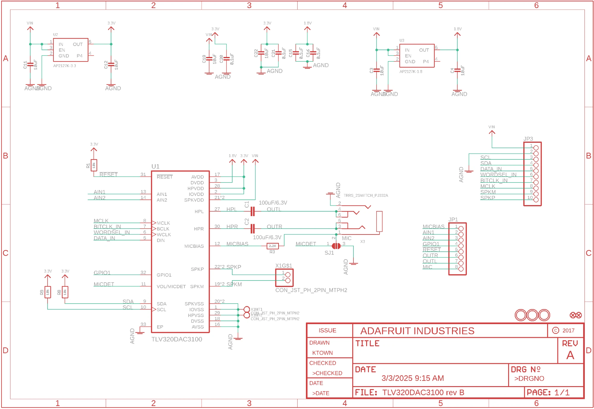
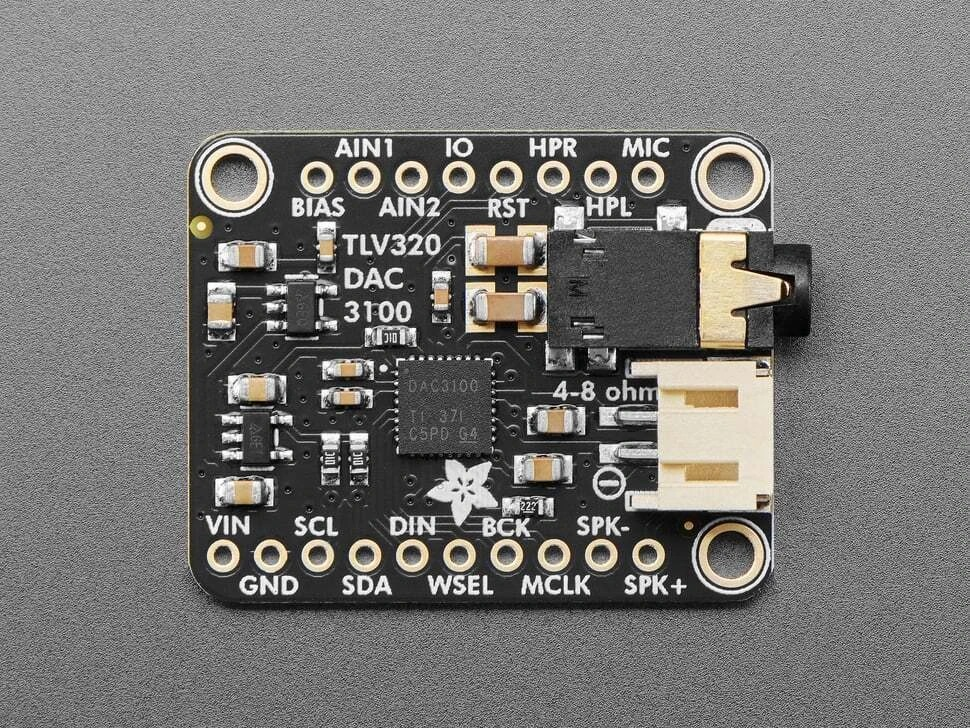
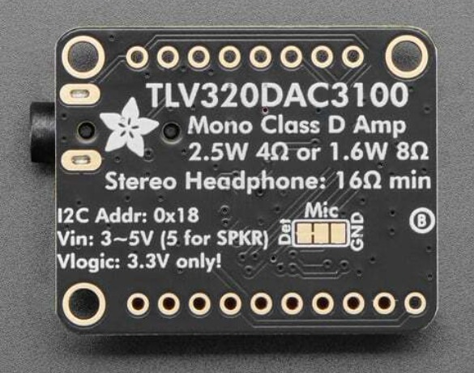

## Propuesta - Módulo a replicar ##
**Adafruit TLV320DAC3100 I2S DAC with Headphone and Speaker Out**. Modalidad: réplica de módulo, realizada nativamente en KiCad.

### Función y objetivo ###
El módulo recibe audio digital por I2S (BCLK, WSEL, DIN) y lo convierte, con el códec TLV320DAC3100, en audio analógico: salida estéreo para auriculares de 16 Ω y salida mono clase D para parlante de 4–8 Ω. Se configura por I2C y permite armar un reproductor de audio completo sin amplificador externo. El objetivo del TP es rediseñar su esquemático y PCB en KiCad aplicando las pautas de la materia.

### Características principales ###
* Códec: TLV320DAC3100, DAC estéreo con SNR de 95 dB y frecuencias de muestreo de 8 a 192 kHz.
* Interfaces de audio: I2S, left-justified, right-justified, DSP y TDM.
* Control: I2C (obligatorio para configurar ganancia y salidas).
* Reloj: la PLL interna genera MCLK a partir de BCLK, por lo que no se necesita MCLK externo (es opcional).
* Auriculares: estéreo, con acople AC, para 16 Ω.
* Parlante: mono clase D, 2,5 W sobre 4 Ω o 1,6 W sobre 8 Ω. Debe conectarse únicamente a un parlante.
* Alimentación: 3–5 V (3 V solo auriculares; 5 V para habilitar el parlante).
* Lógica: 3,3 V únicamente.
* Extras: MIC y BIAS para headset con micrófono (bias de 2 V configurable, detección de headset y de botón), entradas de mezcla AIN1/AIN2 y un GPIO utilizable como IRQ.
* Dimensiones: 33,7 × 25,4 × 7,1 mm.

### Esquematico ###
Lectura hecha sobre la imagen del esquemático publicado por Adafruit.
* U1: TLV320DAC3100 (32 pines más pad expuesto).
* Dos reguladores LDO AP2127K para generar las tensiones de 3,3 V y 1,8 V.
* Capacitores de desacople en las alimentaciones y dos capacitores de 100 µF / 6,3 V de acople AC en las salidas HPL y HPR.
* Pull-ups de I2C y de reset, y resistencia de bias del micrófono.
* Jumper de soldadura SJ1, jack TRRS y conector JST-PH de 2 pines para el parlante.
* Dos headers de pines (JP1 y JP3).
* Estimación: entre 25 y 30 componentes.

### Fotos del módulo ###
**Vista superior**

**Vista inferior**

Imágenes: Adafruit Industries (esquemático de la guía del módulo y fotografías del producto).

* El PCB tendrá componentes únicamente en la cara superior.

### URLs de origen ###
* Producto: https://www.adafruit.com/product/6309
* Guía del módulo: https://learn.adafruit.com/adafruit-tlv320dac3100-i2s-dac
* Pinouts: https://learn.adafruit.com/adafruit-tlv320dac3100-i2s-dac/pinouts
* Descargas: https://learn.adafruit.com/adafruit-tlv320dac3100-i2s-dac/downloads
* Diseño original: https://github.com/adafruit/Adafruit-TLV320DAC3100-I2S-DAC-PCB
* Modelo 3D del módulo (referencia): https://github.com/adafruit/Adafruit_CAD_Parts/tree/main/6309%20TLV320DAC3100%20I2S%20DAC
* Hoja de datos (Rev. C): https://cdn-learn.adafruit.com/assets/assets/000/136/051/original/TLV320DAC3100_Low-Power_Stereo_Audio_DAC_With_Audio_Processing_and_Mono_Class-D_Speaker_Amplifier_datasheet_%28Rev._C%29_-_tlv320dac3100.pdf

